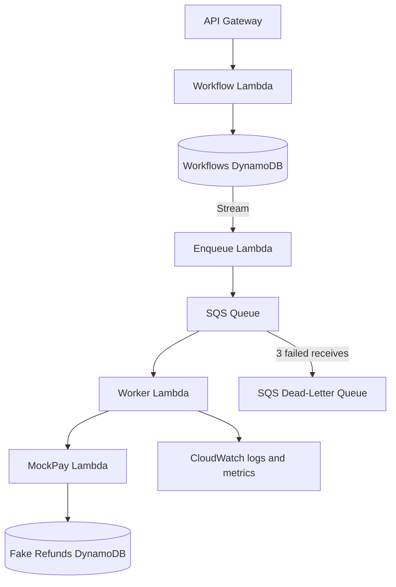

# AgentLedger

> AgentLedger is a serverless execution system that safely recovers AI workflows from crashes and ambiguous external API failures without repeating side effects.

AgentLedger demonstrates the failure that ordinary retries cannot safely solve: an external action succeeds, its response is lost, and the worker cannot tell whether retrying would repeat the side effect. This project uses fake refunds only; it never connects to a payment provider or moves money.

## How it works



Every retry keeps the same key: `refund:{workflow_id}`. The worker checks MockPay before sending a refund. After a timeout, it marks the workflow `UNKNOWN_OUTCOME`, checks MockPay by that key, and only retries after MockPay confirms that no refund exists.

The supported development failure modes are `none`, `timeout_before_success`, `timeout_after_success`, and `worker_crash_after_response`. Failure injection happens on the first attempt only. A genuinely permanent MockPay error remains an SQS batch failure and moves to the DLQ after three receives.

## Run locally

```powershell
python -m pip install -r requirements.txt
python -m pytest -q
python scripts/failure_test.py
```

Expected randomized test result:

```text
workflows=1000
duplicate_refunds=0
lost_refunds=0
```

## Verified AWS result

The stack was deployed to `us-east-1` and the `timeout_after_success` scenario was verified on November 11, 2026:

```text
status=SUCCEEDED
attempts=1
reconciled=true
duplicate_refunds=0
lost_refunds=0
```

The live execution history was:

```text
WORKFLOW_CREATED
ATTEMPT_STARTED
OUTCOME_UNKNOWN
RECONCILIATION_STARTED
WORKFLOW_SUCCEEDED
```

Repeating the MockPay request with the same idempotency key returned the original refund ID, confirming that the deployed conditional write prevented a duplicate.

CloudWatch also confirmed the custom `UnknownOutcome`, `WorkflowReconciled`, and `WorkflowSucceeded` metrics. The dead-letter queue alarm remained healthy with zero visible failed messages during the demonstration.

## Deploy

Prerequisites are an AWS account, configured AWS credentials, and AWS SAM CLI. Keep an AWS Budget alert enabled and delete the demo stack when finished.

```powershell
sam build
sam deploy --guided
```

The stack output `ApiUrl` is the base URL. Start the main demonstration with:

```powershell
$body = @{
  order_id = 'order-123'
  amount_cents = 1000
  failure_mode = 'timeout_after_success'
} | ConvertTo-Json

$workflow = Invoke-RestMethod -Method Post -Uri "$ApiUrl/workflows" -ContentType 'application/json' -Body $body
Invoke-RestMethod "$ApiUrl/workflows/$($workflow.workflow_id)"
Invoke-RestMethod "$ApiUrl/workflows/$($workflow.workflow_id)/events"
```

The final workflow is `SUCCEEDED`, `reconciled` is `true`, and the fake refunds table contains one item. CloudWatch receives structured Lambda logs, `WorkflowSucceeded`, `WorkflowReconciled`, and `UnknownOutcome` metrics in the `AgentLedger` namespace, plus an alarm when the DLQ is non-empty.

## API

- `POST /workflows` — create a fake refund workflow.
- `GET /workflows/{workflow_id}` — inspect state, attempts, and reconciliation.
- `GET /workflows/{workflow_id}/events` — inspect ordered execution history.
- `POST /mockpay/refunds` — create an idempotent fake refund.
- `GET /mockpay/refunds/{idempotency_key}` — reconcile a fake refund.

Workflow states are `PENDING`, `PROCESSING`, `UNKNOWN_OUTCOME`, `RECONCILING`, `SUCCEEDED`, and `FAILED`. No frontend, login, real payments, LLM integration, containers, Kubernetes, or dashboard is included.

